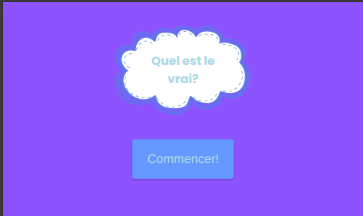
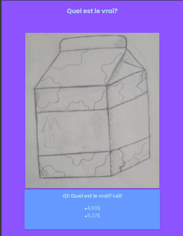
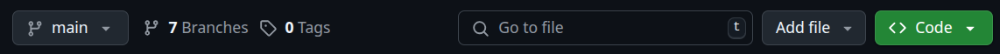
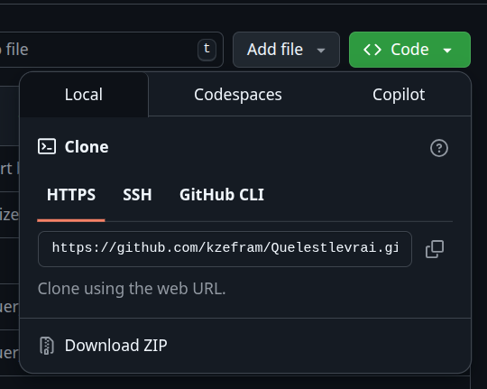

# Quel est le vrai?

## Contents

[Description](#description) |
[TechStack](#tech-stack) |
[Pictures](#photographes) |
[Installation](#installation) |
[Credits](#credits)

## Description

J'ai commencé à jouer à ce jeu en ligne qui consiste à deviner le prix des produits d'épicerie dans l'économie d'aujourd'hui. C'est un bon moyen de se familiariser avec les prix des produits alimentaires. Essayez-le et vous verrez si vous vous débrouillez bien !

## Tech Stack

## Photographes

- Home Page

- Questions Page

- Results Page

## Installation

### Working on the Code

- Vous devrez cloner le dépôt en cliquant sur l'option <>Code en haut à droite de l'écran. (voir photo)

- vous devrez alors copier les URL HTTPS ou SSH pour cloner le dépôt sur votre machine locale. (voir photo)

- Après avoir copié l'URL, allez dans votre terminal/bash/powershell et démarrez le processus d'initialisation du dépôt git. Pour ce faire, créez un dossier dans lequel vous souhaitez que le code soit stocké.

- Après avoir copié l'URL, continuez la procédure prévue pour votre terminal.

- Vous pouvez maintenant aller dans votre éditeur de code, faire un clic droit sur le fichier index.html et cliquer sur l'option ouvrir dans le navigateur ou ouvrir avec le serveur live.

### Opening link

- Il n'y a pas d'installation pour cette option. Tout ce que vous avez à faire est de cliquer sur le lien ci-dessous.

[Quelestlevrai](https://kzefram.github.io/Quelestlevrai/)

## Credits

- Karen Bourgeois
- Zack Bourgeois

